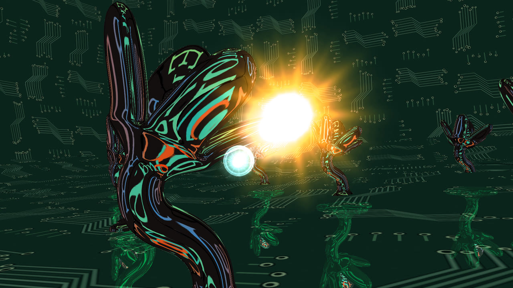
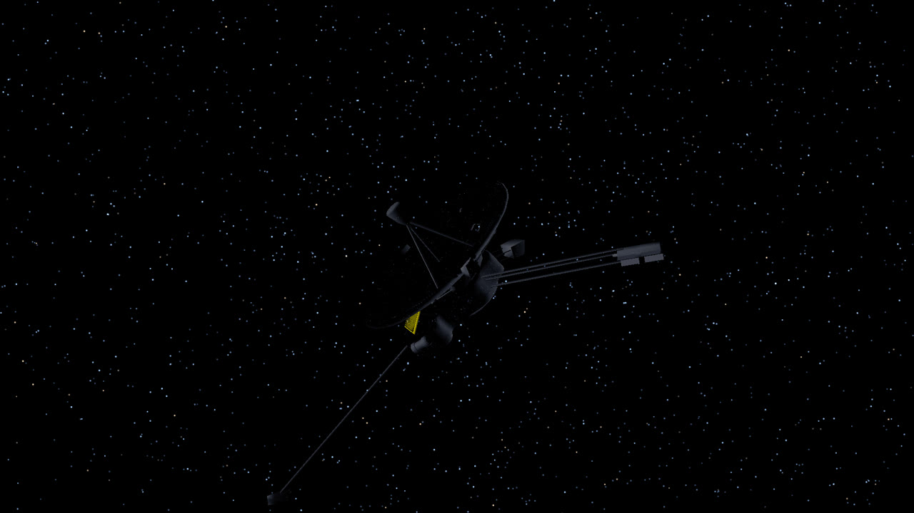
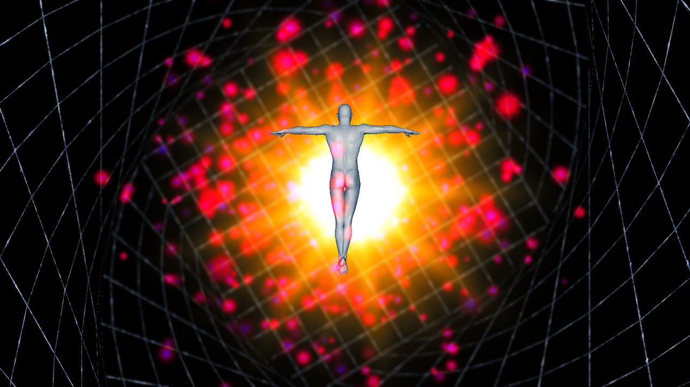
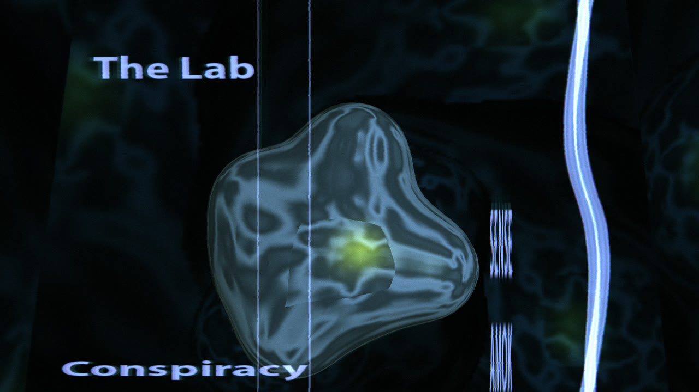
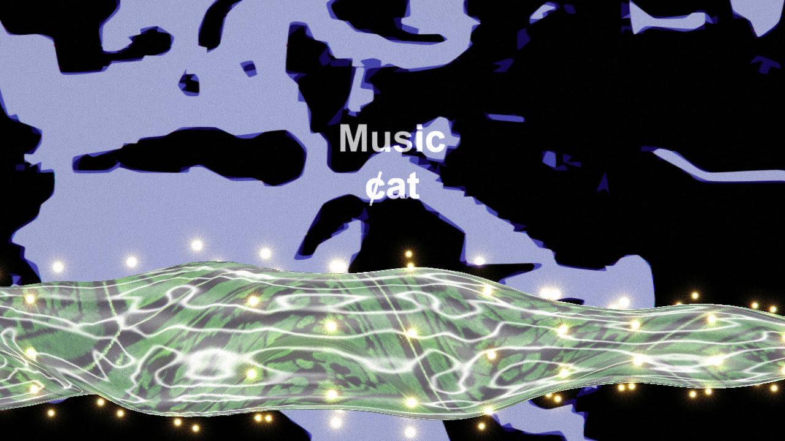
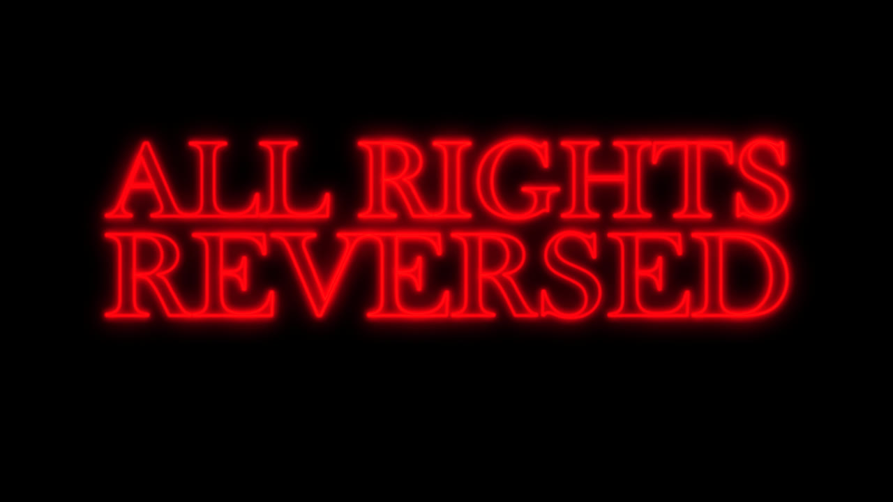
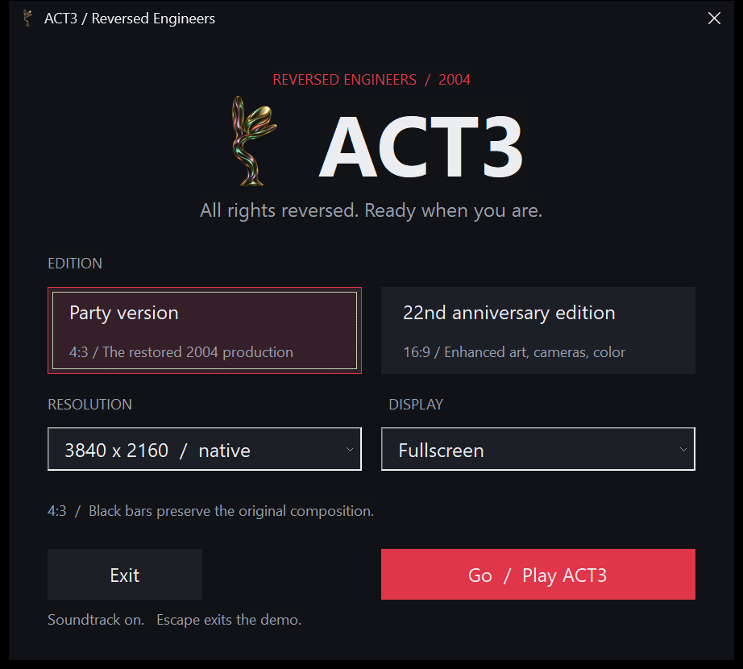

# ACT3

**A 2004 demoscene production. Restored, remastered, reversed.**



ACT3 is Reversed Engineers' first PC demo, originally presented at **React 2004**.
This restoration brings its surviving C++ source back to life through **OpenGL**,
with the original soundtrack and a separate **22nd anniversary edition** for modern screens.

This restoration and the 22nd anniversary edition are **a personal project by
Michalis, ACT3's original programmer**. They are **not an official Reversed Engineers
release**. The group name and credits refer to the original 2004 production.

The work was developed with AI assistance under Michalis's direction:
recover the production first, then revisit its art and cinematography without
turning the historical source into a rewrite.

[Original production on Pouët](https://www.pouet.net/prod.php?which=12245) ·
[Restoration story](docs/restoration.md) · [Source preservation](docs/code-provenance.md) ·
[Credits](docs/credits.md) · [MIT license](LICENSE)

## Two editions, one production

| | Party version | 22nd anniversary edition |
| --- | --- | --- |
| Direction | Restore the original presentation | Revisit the same journey |
| Composition | 4:3 | 16:9 |
| Models and music | Original | Original |
| Cameras | Original recorded tracks | New direction, with selected original passages retained |
| Artwork | Original release assets | Reconstructed HD art and finer surface detail |
| Finish | Original effects through the restored backend | Scene-specific grading, focus and music-reactive film texture |

**The default is Party version, fullscreen, at the display's current resolution.**
Black bars preserve the selected edition's aspect ratio on other displays;
the picture is not stretched. Both editions keep the same scene sequence and
approximately **3 minutes 43 seconds** of presentation.

Party version is a restoration rather than a promise of pixel-identical emulation.
OpenGL rasterization, driver behavior and the original frame-rate-dependent
feedback can produce differences from the 2004 executable.

## The anniversary journey

| Space | Shadow |
| --- | --- |
|  |  |
| A plaque becomes a three-dimensional discovery. New orbital shots, HD engravings and the original two-layer starfield idea. | A dark psychic atmosphere, a dolly zoom, directed depth of field and abrupt negative/flash accents. |

| Greetz | Credits |
| --- | --- |
|  |  |
| A mysterious organic presence separated from the disorienting feedback, with neon DNA and greetings. The original staggered squash/stretch animation stays. | HD artwork, widescreen framing and green liquid chrome, ending in a static red optical-film title. |

The electronic flowers remain the quiet center of the demo: a moving camera
enters their forest while keeping the light in view. Finer circuit traces and a
coherent green/copper palette emphasize the contrast between the surrounding
technology and the flowers' stillness. The original camera takes over for the
harp passage and the final approach into the egg.

The anniversary edition also adds:

- **Native-resolution rendering**, with scene-specific color LUTs and selective
  depth-aware corrections where glare would otherwise obscure the subject.
- **96³ marching-cubes sampling** for the blob, compared with the original 40³.
  Surface-following traversal remains; a direct visited-cell lookup supports the finer grid.
- **Music-reactive film texture:** fine irregular grain, restrained halation,
  chromatic dispersion and small registration disturbances. Each scene has a
  dramatic envelope, modulated by live spectral attacks from the soundtrack.
- **HD graphics with artistic continuity:** reconstructed overlays, circuit and
  room textures, plaque detail, credits art and a new electronic-flower launcher emblem.



## Run it

### Windows

Open the executable, choose an edition and resolution, and press **Go**.
The native dark Win32 launcher uses Windows controls, WIC and GDI;
there is no third-party GUI runtime to distribute.



To build with Visual Studio 2022, install **Desktop development with C++**,
a Windows SDK and CMake:

```powershell
cmake -S . -B build -G "Visual Studio 17 2022" -A x64
cmake --build build --config Release
```

Open `build/ACT3.sln`, select `act3`, and press **F5** for the launcher.
The generated project supplies the working directory and assets.
The Release executable is `build/Release/act3.exe`.

### Linux

Linux has a terminal interface instead of a settings GUI. It uses **X11/GLX**,
**XRandR** for display modes and the same OpenGL renderer and miniaudio playback.
A desktop OpenGL compatibility context is required; a core-only or OpenGL ES
context is not the target of this restoration.

On Debian/Ubuntu, the development dependencies are:

```sh
sudo apt install build-essential cmake libx11-dev libxrandr-dev libglvnd-dev libpng-dev
cmake -S . -B build -DCMAKE_BUILD_TYPE=Release
cmake --build build -j
./build/act3
```

**Linux support is implemented but has not yet been build- or runtime-tested.**
Windows is the validated platform so far. Linux testing and portability fixes
are welcome; a native Wayland backend is not currently included.

### Command-line options

```sh
./act3                                         # Party / native / fullscreen / music
./act3 --extra                                 # 22nd anniversary edition
./act3 --extra --windowed --resolution=1920x1080
./act3 --original --fullscreen --resolution=1920x1080
./act3 --help
```

On Windows, add `--no-ui` to bypass the launcher. `--space`, `--shadow`, `--blob`,
`--credits` and `--sequence` open development previews; soundtrack playback is
provided by the full-demo path. `--verbose` enables resource diagnostics.
**Escape exits playback.** Terminal color respects `NO_COLOR` and redirected output.

Original assets are included in `assets/original/`; no adjacent archive checkout,
legacy DirectX SDK or 2004 audio DLL is needed. Keep the generated `assets/`
directory with the executable when copying a build.

## How the restoration works

The original scene and mesh code remains the source of the production.
A small D3D9-shaped compatibility layer translates its buffers, transforms,
materials, texture stages and drawing operations into desktop OpenGL.
CMake extracts historical methods and adapts selected translation units into
the build directory, where portability adjustments and enhancement hooks live.

```text
historical scene / camera / mesh C++
                 |
       configure-time adapters
                 |
       D3D9-compatible API subset ---- optional anniversary hooks
                 |                              |
              OpenGL <---------------- cameras / art / grading
                 |
       4:3 or 16:9 presentation

original MP3 --> miniaudio --> playback clock + live FFT --> timeline / post effect
```

The audio callback drives the demo clock. A 2048-sample Hann-windowed FFT supplies
spectral bands and an orchestral attack envelope for the finishing pass;
those pulses are derived during playback rather than entered as beat events.
The renderer uses compatibility OpenGL and GLSL 1.20 post-processing.

| Location | Responsibility |
| --- | --- |
| Root C++ files | Recovered historical source, with narrowly scoped necessary edits |
| `compatibility/` | D3D9/D3DX subset implemented over OpenGL |
| `recreated/` | Player host, original-scene integration, audio and presentation |
| `extra/` | Anniversary cameras, shaders, grading and replacement art |
| `platform/` | Windows launcher/window and Linux CLI/display handling |
| `assets/original/` | Original release music, meshes, camera tracks and textures |

## How much historical code changed?

Against the recovered baseline, **63 of 12,783 historical source lines were changed
or removed: 0.49%**. Another **71 lines were added inside historical files**.
Unchanged historical lines make up **68.05% of the final first-party source tree**.

These are deliberately defined **source-line figures**, not a percentage of
runtime behavior or executable bytes. They exclude miniaudio, assets, documentation
and generated duplicate files. The source tree also retains old engine/editor paths
that the modern player does not compile. Configure-time adaptations are real work
and are not hidden inside the small historical-file diff.

See the [full method and limitations](docs/code-provenance.md), or reproduce it:

```sh
python tools/source_metrics.py
```

## A few restoration moments

1. **The flower returned first.** A wireframe established the OpenGL path; the
   original 3DS loader, mesh rendering, materials, reflections and flares then took over.
2. **The original executable became a visual reference.** Captures across the demo
   helped distinguish intended feedback and transitions from porting artifacts.
3. **The transitions mattered as much as the scenes.** The Space-to-Shadow vortex,
   the release into the flower forest and the egg-to-blob connection were retained
   as structural parts of the production.
4. **The new edition was directed one scene at a time.** Original animation and
   musical passages survived where they carried the scene; new cameras, light,
   focus and color were judged in motion with the original soundtrack.

More in the [restoration notes](docs/restoration.md).

## License and credits

[MIT](LICENSE). Original credits: **msamurai** (code), **quiesce** (3D),
**sybeX** (2D) and **cat** (music). Original in-demo credit styling is preserved.
[miniaudio](third_party/miniaudio/VERSION) retains its public-domain/MIT-0 terms.
See [credits and third-party notices](docs/credits.md).

**All rights reversed.**
